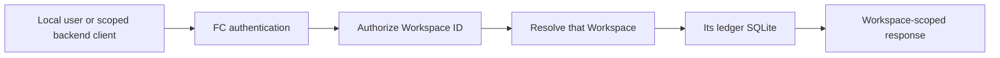
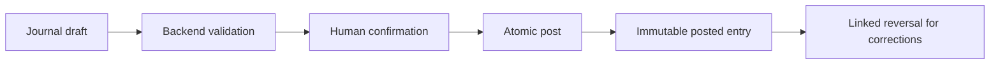
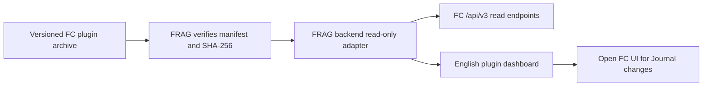

# Finance Core 3.2.0

Finance Core (FC) is a local-first finance domain and data service with its own standalone UI. An optional, separately released FRAG-harness plugin can read a small, selected set of FC records. FC remains independently runnable and is the only runtime that writes its finance SQLite files.

The standalone UI and the optional plugin use English. FC does not import FRAG, SFOS, LLM services, or private research files.

## Architecture


The diagram has an [editable Archify specification](docs/architecture/finance-core-overview/finance-core-overview.archify.json) and a [standalone interactive viewer](docs/architecture/finance-core-overview/finance-core-overview.html) that can be downloaded and opened locally.

The UI and plugin use HTTP contracts. Domain rules do not depend on FastAPI, SQLite, the UI, or FRAG. A User, Workspace or Vault, and finance Account are distinct concepts. Every finance request names a Workspace.

FC provides Journal drafts and posting, commodities and typed accounts, explicit prices and FX valuation, lots and derived holdings, recurring draft generation, living accounts and monthly plans, reports and reconciliation, JSON and CSV import or export, backup, and operation-level undo. It does not provide trading, payments, bank or broker connections, live market data, model analysis, or investment advice.

## Install and run

Requirements: Node.js, npm, Python 3.12, and `uv`. Run these commands from the repository root:

```powershell
npm.cmd install --offline
uv sync --project backend --cache-dir .tmp/uv-cache
```

Set a long random `FINANCE_CORE_ADMIN_TOKEN` in your environment before starting FC. `.env.example` lists supported variables; keep real values out of Git. `FINANCE_CORE_DATA_ROOT` is optional.

```powershell
$env:FINANCE_CORE_ADMIN_TOKEN = "<long-random-local-secret>"
npm.cmd run dev
```

- Standalone UI: `http://127.0.0.1:5174`
- API: `http://127.0.0.1:8788`
- OpenAPI: `http://127.0.0.1:8788/docs`

To start only the API, run `npm.cmd run dev:api`. The standalone UI uses the published `/api/v3` HTTP API. It never reads SQLite or backend objects directly. The React 19.3 UI uses paper white (`#F8F8F4`), ink (`#101412`), teal (`#087F68`), system fonts, and original SVG identity assets. Components are implemented locally; reference libraries are not copied.

## Workspace and Journal flow



A Vault owns one complete finance SQLite. Requests cannot silently merge records across Vaults. Scoped access tokens belong on a backend, never in browser assets. Synthetic sample loading is available only for an empty sandbox Vault.



Amounts, quantities, costs, prices, and rates remain canonical Decimal strings in the public contract. Cross-commodity postings require an explicit valuation rate and rate type. Lot disposal requires explicit allocations; FC does not choose FIFO, LIFO, or a tax policy for the user. Posted entries cannot be edited or deleted.

## API and compatibility

The public API is rooted at `/api/v3`. `GET /api/v3/health` reports the API version and optional build or release commit metadata without paths or secrets. Version 3.1.1 corrects named OpenAPI response schemas for Journal and read models without changing runtime business semantics. `DraftValidationResponse` exposes `workspaceId`, `valid`, `issues`, and `preview`. Legacy `/api/v1` and `/api/v2` HTTP routes are no longer registered.

Control routes cover sessions, the current user, Workspaces, access tokens, and undo. Finance routes are scoped under `/api/v3/workspaces/{workspaceId}/...`. The [released OpenAPI artifact](docs/release/finance-core-v3.2.0-openapi.json) is the detailed endpoint and field contract.

Patch releases make compatible fixes. Minor releases may add endpoints or optional fields. Removing, renaming, changing requiredness, or changing semantics requires a new major version. FC 3.2.0's released OpenAPI artifact and manifest are in `docs/release/`.

Ordinary reversible create, update, delete, import, batch, balance-recording, and backup-restore operations return an operation ID, undo token, expiry, Workspace ID, and operation type. Undo is single-use, expires after ten minutes, and is invalidated by a later write. Posted facts use linked reversal instead of ordinary undo.

## Optional FRAG plugin



The plugin archive has exactly `manifest.json`, `adapter.py`, and `ui.js` at its root. It requires FRAG plugin protocol 1, FRAG host 1.0.0 or later, and FC API 3.1.1. The adapter exposes read-only dashboard and scope routes and reads at most ten explicitly selected Journal records from one authorized Workspace per request. FC credentials stay on the backend. All Journal mutations happen in FC's own UI after FC authentication.

See the [plugin archive contract and verification guide](docs/md/02-frag-finance-core-plugin.md). FRAG installation and release are separate repository tasks.

## Migration and data safety

Inspect a source database read-only, then use a dry run before any real migration:

```powershell
uv run --project backend python -m finance_core.maintenance inspect --source '<source-db>'
uv run --project backend python -m finance_core.maintenance migrate --source '<source-db>' --data-root '<new-data-root>' --display-name '<workspace-name>' --kind personal --dry-run
```

A real migration requires stopped writers, a backup, and separate `REAL_DATA_MIGRATION_APPROVED` authorization. The migration copies into a new Vault, validates SQLite integrity and foreign keys, and compares row counts and hashes. It does not overwrite or delete the source. Workspace deletion moves explicitly validated files into recoverable quarantine; permanent removal is a separate operation.

Do not commit real finance data, SQLite files, exports, backups, credentials, or personal planning files. Tests use synthetic fixtures and temporary or in-memory SQLite.

## Verify

```powershell
npm.cmd test
npm.cmd run build
npm.cmd run test:ui
npm.cmd run check:versions
npm.cmd run check:release
python tools/build_frag_plugin.py --check
```

The release check compares the generated OpenAPI schema and hash with the published API 3.1.1 artifact for product 3.2.0. The plugin check verifies the archive contents and pinned hashes. Changes to FC and FRAG require separate review, commits, tags, and releases.

## React UI structure and compatibility

Product 3.2.0 keeps API 3.1.1, ledger schema 2, registry schema 1, and the optional FRAG protocol-1 plugin 1.0.0. A new product version does not require the consumer to change its pinned HTTP contract. The 3.2.0 OpenAPI snapshot is semantically identical to 3.1.1. Security fixes enforce existing Workspace read/write and lifecycle boundaries.

`demo/src/main.jsx` mounts the React application. The app shell owns hash navigation, session entry and Workspace selection. Feature pages own their forms. The API client and request coordinator cancel obsolete reads, retain Decimal strings and prevent duplicate writes; the backend owns calculations and persistence. Master data and Settings occupy the upper configuration navigation. The financial navigation follows Journal → T-accounts → Securities & positions → Cash flow → Statements. Plans, import/export and master data use contextual tabs. Journal steps require backend validation and explicit confirmation; changing a draft invalidates the preview. Import structure checking does not claim financial validation.

Desktop form selects share a dark menu with a moving highlight, keyboard navigation and native form submission; screens up to 600px use native selects. Journal and import show animated step pages with reduced-motion support. Main navigation retains the current page until the target's scoped reads complete, then changes its page and data together. Loading and notifications do not move the layout. Confirmed tab changes reset discarded forms; failed page loads retain input and unsaved-change protection. See [UI interaction fixes and verification](docs/md/04-ui-interaction-fixes.md).

The refined navigation uses one selected surface on a quiet rectangular rail, with text-only hover feedback. Pages, contextual tabs and Journal/import steps share a 220ms vertical transition; section controls reserve the same height. The FINCR wordmark and complete-wordmark favicon are black SVG paths redrawn from the supplied reference. The accounting CSV template is recognized alongside standard FC posting CSV: explicitly confirm parent/child row grouping, map accounts, review the draft preview, then submit to existing backend validation. Amounts stay strings, missing or inactive commodity codes open a reasoned rejection dialog; account/currency configuration blocks invalid imports, and mixed-currency drafts require explicit rates in standard FC format. Raw CSV validation rejects duplicate headers, extra cells, malformed quotes and invalid UTF-8. See [navigation, identity and CSV verification](docs/md/05-navigation-csv-validation.md).

Workspace archive, quarantine, restore and ledger requests share a stable per-Vault lock. Global ledger undo uses the same authorization and status rules. Quarantine/restore preflight all files, move explicit files individually, and compensate if a move or registry transaction fails. No directory purge is performed. These protections coordinate requests in one FC process; run one FC writer process for a configured data root. Filesystem movement and SQLite cannot form one crash-atomic transaction; preserve backups and seek manual review after an interrupted filesystem operation.

Production output is **`dist/v3.2.0/`**, containing the frontend and `THIRD-PARTY-NOTICES.txt`. Builds overwrite stable filenames without recursively clearing output directories. Earlier ignored `dist` output is not part of the current bundle. React 19.3.0, React DOM 19.3.0 and scheduler 0.28.0 are pinned; build checks verify their reviewed MIT notices and reject legacy API routes, browser storage, bundled fonts and private data/rule assets. No website deployment is included.

For synthetic local browser verification, run an isolated backend with a project-local temporary data root and set `FC_UI_API_TARGET` for the Vite proxy. The browser smoke tool uses the installed Archify Chrome transport via `ARCHIFY_SKILL_ROOT` (or the user's installed skill directory). All profiles, screenshots and synthetic data belong in ignored `.tmp/`; never point this test at a personal Vault. Existing Horizon 3.0.0 remains a candidate-direction baseline, not a promise of implemented features.

Long Decimal strings are calculated with operand-sized local precision, including reporting sums and exact half-even lot allocation; the ambient Python Decimal precision cannot silently truncate these values. The HTTP schema, rounding policy and SQLite formats are unchanged. FastAPI's declared minimum is 0.121 for function-scoped dependency cleanup; the locked and tested 0.141.1 dependency is unchanged.

The architecture viewer and exported SVG are generated with approved Archify 2.17.0-dev.1. Its MIT text is distributed in [LICENSE-Archify.txt](docs/architecture/finance-core-overview/LICENSE-Archify.txt); the bundled JetBrains Mono OFL notice remains embedded in both artifacts. These documentation fonts are absent from the application bundle. See [3.2.0 validation and handoff](docs/md/03-fc-v3.2-validation.md) for evidence and limits.

Brand assets are kept in `public/branding/`: the UI loads `/branding/logo.svg` and the document icon loads `/branding/favicon-fincr.svg`. Both are black SVG silhouettes derived from the supplied source PNG, which remains local and ignored.

The configuration gate requires an authenticated owner session, an available Workspace, and at least two active accounts supporting the same active currency. Archived records remain readable. Account commodity permissions accept multiple registered codes; explicit prices and external access tokens are not required for ordinary Journal use. Import & export opens CSV import by default, and Journal provides import/export shortcuts. Downloads report failures inside the UI; postings CSV includes only posted entries. Exported CSV now carries its balancing commodity and Journal context so the supported currency journal workflow can be reimported as drafts. Use JSON backups for complete ledger recovery, including security-lot metadata. See [configuration, session and CSV round-trip verification](docs/md/06-configuration-csv-roundtrip.md).
