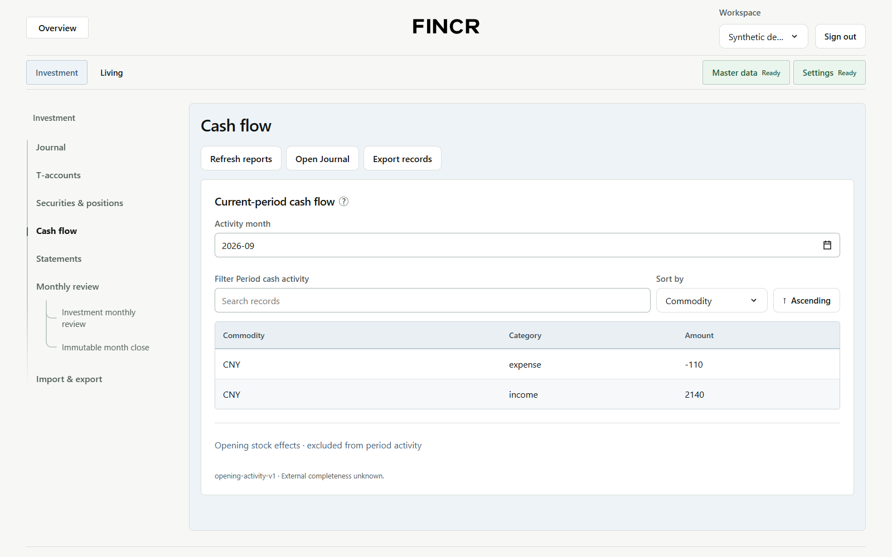
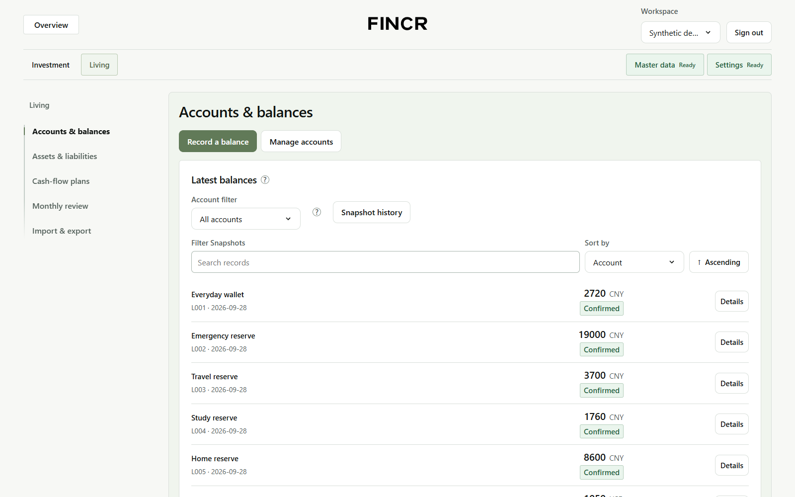

# Finance Core 3.10.0

A local-first finance workbench for Investment and Living records. FC owns financial rules, exact calculations and each Vault's SQLite; it runs without FRAG, model providers or external financial services.

[](LICENSE)
[](https://github.com/O-u-i/Finance-Core)

[Issues](https://github.com/O-u-i/Finance-Core/issues) · [Pull requests](https://github.com/O-u-i/Finance-Core/pulls)

**Investment — Synthetic demo data**



**Living — Synthetic demo data**



## Features

- Investment and Living workbenches with Workspace-scoped records and reports.
- Exact financial calculations, draft validation and explicit posting.
- Local Vault storage, backups and optional read-only evidence sharing with FRAG.

## Technology

- **UI:** React 19, JavaScript and Vite; desktop-first.
- **API:** Python 3.12, FastAPI and Pydantic; Workspace-scoped `/api/v3`.
- **Data:** local SQLite, canonical Decimal strings, explicit validation/posting and reversible operations where supported.
- **Tools:** Node.js **22+**, npm and `uv`. Lockfiles pin dependencies.

## First use

Install Python **3.12**, Node.js **22+**, npm and `uv`. Clone with Git (or
download/extract the source and start from its repository root):

```powershell
git clone https://github.com/O-u-i/Finance-Core.git
Set-Location Finance-Core
npm.cmd ci
uv sync --project backend --locked --cache-dir .tmp/uv-cache

$env:FINANCE_CORE_ADMIN_TOKEN = "<long-random-secret-from-your-password-manager>"
npm.cmd run dev
```

1. Open **http://127.0.0.1:5174** and sign in with that admin token.
2. Start with a new empty **Sandbox** Vault for synthetic examples; use a separate **Personal** Vault when ready for real records.
3. Complete **Master data** and **Settings** before entering records. Journal imports create drafts; posting requires separate confirmation.

The API listens at `127.0.0.1:8788`; OpenAPI is at `http://127.0.0.1:8788/docs`. `npm.cmd run dev:api` starts only the API. Both development servers bind to loopback. Do not expose them through port forwarding, a public proxy or `--host 0.0.0.0`.

Keep the same secret in your password manager and set it in the launch shell. The example is a placeholder, not a usable secret; `.env.example` lists supported variables and is **not loaded automatically**. Optional `FINANCE_CORE_DATA_ROOT` selects the storage root; the default is ignored `.local-data/v3`. Startup does not attach an external Vault or import personal files. [Environment details](docs/md/01-fc-v3-api-env-loading.md).

## Usage

With FC running, use a second PowerShell window to check the API:

```powershell
Invoke-RestMethod 'http://127.0.0.1:8788/api/v3/health'
```

A health response confirms the API is reachable, not that financial records are
complete. Keep the new Sandbox selected and define its commodities/accounts in
**Master data**, then try either workflow:

- **Investment → Journal:** create a synthetic draft, validate/review it and post explicitly; inspect **Cash flow** or **Statements**.
- **Living → Accounts & balances:** choose **Record a balance**, confirm its actual date and inspect **Latest balances**. This does not create a Journal entry.

Journal imports remain drafts until separately posted; forecasts do not post transactions.

## Update

1. Save a full Vault backup **outside Git**, then stop FC. Use format 4 when debt arrangements exist.
2. Review your local changes, then fetch and switch to the intended reviewed revision. Never overwrite local work blindly.
3. Refresh dependencies and restart with the same data root and secret:

```powershell
npm.cmd ci
uv sync --project backend --locked --cache-dir .tmp/uv-cache
npm.cmd run check:versions
npm.cmd run dev
```

Opening a Vault does not authorize a schema migration. Do not run an older writer against an extended Vault without a full compatible backup and a reviewed rollback path. FC supports one writer process per configured data root.

## Repository layout

```text
backend/finance_core/  Domain rules, application operations, API and SQLite adapters
backend/tests/         Synthetic backend and contract tests
demo/src/              Standalone React UI and Workspace-scoped client
demo/tests/            UI behavior and development-server safety checks
plugins/finance-core/  Official optional FRAG reader source
public/                Branding and distribution license notices
tools/                 Build, verification and synthetic browser helpers
docs/md/               Usage, accounting and API notes
docs/release/          Released OpenAPI contracts and pinned reader archives
docs/architecture/     Architecture diagram and local viewer
```

Ignored `.local-data/`, `.local-acceptance/`, `test/`, `private/` and `.tmp/` are not distributable source. Build output is `dist/v3.10.0/`.

## Data and access boundaries

- Every finance request names a Workspace. The UI never opens SQLite or calculates financial amounts.
- Admin sign-in uses an HttpOnly, SameSite session cookie. Scoped access tokens belong in authorized local backend clients, never browser storage, chat or Git.
- The UI development server serves UI inputs, not backend files, Vault storage or private/test directories. `public/` is public and copied into builds: never store private files there. This is not an operating-system sandbox.
- Missing observations and external completeness stay **unknown**, not invented zeroes. Reports retain separate currencies; forecasts never create transactions or payments.
- Backups, exports, credentials, journals, screenshots and personal plans stay outside Git. Tests use isolated synthetic data, never an existing personal Vault.
- No bank/broker/market connectors, trading, transfers, automatic deployment or production migration are included. Local application checks cannot guarantee security against a compromised OS, browser, dependency or public server configuration.

[Unified accounting](docs/md/05-unified-personal-accounting.md) · [Opening balances](docs/md/06-opening-balances-and-notes.md) · [Economic evidence](docs/md/10-economic-evidence-and-debt-timing.md) · [Month-to-date review](docs/md/11-month-to-date-review.md)

### API permissions and cleanup

- **Settings → API access** creates general local-client tokens: **Read** grants only `ledger:read`, **Write** only `ledger:write`, and **Both** grants both. These are not FRAG connection configurations; **Connect FRAG** remains read-only.
- **Settings → Issued access:** revoke an active token first. Revoked or expired tokens offer **Delete permanently**, requiring the exact token name. This removes its token record/read grant, not audit history.
- **Settings → Workspaces:** quarantine a Vault first, then choose **Delete permanently** and type its exact name. This owner-only action has **no undo**: it removes one quarantined database and its Vault record, invalidates its workspace undo records, and revokes tokens containing that Vault. Extra files or changed/linked paths block deletion for manual review. Directories, backups, exports and audit history are retained; this is not secure erasure.
- If deletion fails or times out, refresh and review before an explicit retry: irreversible deletion may already have started. FC never automatically retries it.

## Optional FRAG connection

In **Settings → Connect FRAG**, choose one Vault and a read-only range, then copy its private connection configuration. In VS Code, use **FRAG: Connect Finance Core**, check the connection and explicitly authorize the smaller evidence selection. Never give FRAG the owner token or direct SQLite access.

Compatible versions: **FC product/API 3.10.0 · reader 1.10.0 · protocol 2 · FRAG 1.13.4**. Existing byte-pinned reader archives are unchanged.

[Reader access and authorization](docs/md/12-financial-reader-access.md) · [Plugin contract](docs/md/02-frag-finance-core-plugin.md) · [OpenAPI](docs/release/finance-core-v3.10.0-openapi.json)

## Verify and build

```powershell
npm.cmd run test:ui
npm.cmd test -- --basetemp ".tmp/pytest-$(Get-Date -Format 'yyyyMMdd-HHmmss-fff')"
npm.cmd run build
npm.cmd run check:versions
npm.cmd run check:release
uv run --offline --no-sync --project backend --cache-dir .tmp/uv-cache python tools/build_frag_plugin.py --check
```

Choose a fresh repository-local pytest base directory. Browser helpers must target an isolated synthetic API, never a personal Vault or the user's browser profile. Automated tests, build success, visual review and live acceptance are separate checks.

[Architecture preview](docs/architecture/finance-core-overview/finance-core-overview-light-2048.png) · [Editable diagram](docs/architecture/finance-core-overview/finance-core-overview.archify.json) · [Local viewer](docs/architecture/finance-core-overview/finance-core-overview.html)

## Contributing

[Issues](https://github.com/O-u-i/Finance-Core/issues) and focused
[pull requests](https://github.com/O-u-i/Finance-Core/pulls) are welcome. For help or a bug report, include
the version, expected/actual behavior and a minimal synthetic reproduction.
Never attach a personal Vault, real journals, credentials or unredacted exports.

Use [Verify and build](#verify-and-build) for checks. Keep financial calculations
in the backend, preserve Workspace isolation and update affected usage/API
documentation. Original-code contributions use MIT unless explicitly agreed
otherwise; preserve all third-party notices.

## License

Original code and documentation use the [MIT License](LICENSE).

Third-party licenses remain separate. React Bits `BranchedMenu` retains [MIT + Commons Clause](public/REACT-BITS-LICENSE.txt), so the complete frontend is **not MIT-only**. Preserve [third-party notices](public/THIRD-PARTY-NOTICES.txt), font OFL notices and the [Archify notice](docs/architecture/finance-core-overview/LICENSE-Archify.txt) with their material. Frontend builds include `LICENSE.txt`; Python distributions include `backend/LICENSE`. Distribute the repository license alongside separately distributed reader archives without changing their pinned bytes.
