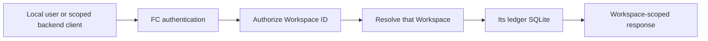
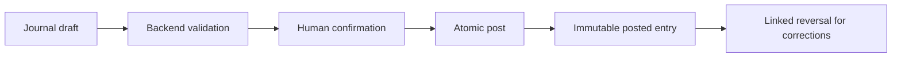
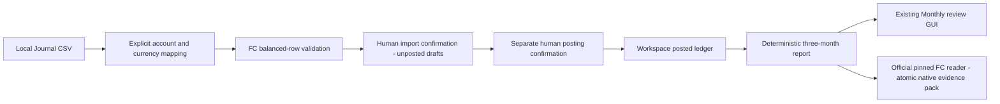
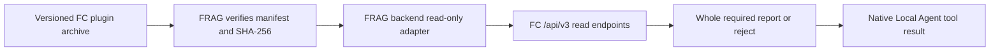

# Finance Core 3.7.0

[Desktop financial workbench](docs/md/08-desktop-workbench.md): centered FINCR identity, independent cross-segment Overview records, segment rails, shared compact record rows, four-column T-account summaries and read-only posting details. Product/API 3.7.0 adds a Workspace-scoped GET contract and optional date context without changing financial calculations or database schemas. No dependency, connector or production installation is added. The optional reader 1.7.0 pins API 3.7.0 without expanding its permissions; FRAG installation/pin synchronization remains separate.

[Unified personal and investment accounting](docs/md/05-unified-personal-accounting.md): one Vault, Investment Journal plus Living actual-date balances, general beneficiary agreements, manual assets and reconciliation. Living permits multiple observations per account/day, shows latest balances with folded history, and reviews each month's latest recorded date. Missing months are unknown; differences are not income or spending. The existing horizontal navigation is retained. Local builds are not production migration, installation or publication.

Overview is display-only; horizontal segment navigation is sticky. Desktop navigation and section spacing stay compact, selected tabs keep readable text contrast, amounts align to the right, and scroll targets remain below the sticky bar. Master data scopes its account registry to the selected Investment/Living segment, orders codes naturally, and provides code/name, type, commodity and status filters without modifying records. Registration retains safe unused-account deletion and history-preserving end-purpose controls. Living snapshots show paged latest-per-account readouts with expandable history. Schema-2 Vaults retain their original storage and require explicit migration for dated Living lifecycle and personal reconciliation; compatibility is handled in the relevant controls, without a page-wide Schema banner.

Commodity registration distinguishes unused codes from configuration/history references. Only unused commodities can be deleted; referenced codes may be deactivated without erasing history. Overview hides inactive unused currencies and empty ownership cards, while retaining referenced currencies and leaving backend calculations and confirmed closes unchanged.

Finance Core (FC) is a local-first finance domain and data service with its own standalone UI. An optional, separately released FRAG-harness plugin can read a small, selected set of FC records. FC remains independently runnable and is the only runtime that writes its finance SQLite files.

The standalone UI and the optional plugin use English. Desktop GUI is the delivery target; mobile GUI is out of scope. FC does not import FRAG, SFOS, LLM services, or private research files.

## Architecture


The diagram has an [editable Archify specification](docs/architecture/finance-core-overview/finance-core-overview.archify.json) and a [standalone interactive viewer](docs/architecture/finance-core-overview/finance-core-overview.html) that can be downloaded and opened locally.

The UI and plugin use HTTP contracts. Domain rules do not depend on FastAPI, SQLite, the UI, or FRAG. A User, Workspace or Vault, and finance Account are distinct concepts. Every finance request names a Workspace.

FC provides Journal drafts and posting, commodities and typed accounts, explicit prices and FX valuation, lots and derived holdings, recurring draft generation, living accounts and monthly plans, reports and reconciliation, JSON and CSV import or export, backup, and operation-level undo. It does not provide trading, payments, bank or broker connections, live market data, model analysis, or investment advice.

## Install and run

Requirements: Node.js, npm, Python 3.12, and `uv`. Run these commands from the repository root:

```powershell
npm.cmd install --offline
uv sync --project backend --cache-dir .tmp/uv-cache
```

Set a long random `FINANCE_CORE_ADMIN_TOKEN` in your environment before starting FC. `.env.example` lists supported variables; keep real values out of Git. `FINANCE_CORE_DATA_ROOT` is optional.

```powershell
$env:FINANCE_CORE_ADMIN_TOKEN = "<long-random-local-secret>"
npm.cmd run dev
```

- Standalone UI: `http://127.0.0.1:5174`
- API: `http://127.0.0.1:8788`
- OpenAPI: `http://127.0.0.1:8788/docs`

To start only the API, run `npm.cmd run dev:api`. The standalone UI uses the published `/api/v3` HTTP API. It never reads SQLite or backend objects directly. The React 19.3 UI uses paper white (`#F8F8F4`), ink (`#101412`), teal (`#087F68`), system fonts, and original SVG identity assets. Components are implemented locally; reference libraries are not copied.

## Workspace and Journal flow



A Vault owns one complete finance SQLite. Requests cannot silently merge records across Vaults. Scoped access tokens belong on a backend, never in browser assets. Synthetic sample loading is available only for an empty sandbox Vault.



Amounts, quantities, costs, prices, and rates remain canonical Decimal strings in the public contract. Cross-commodity postings require an explicit valuation rate and rate type. Lot disposal requires explicit allocations; FC does not choose FIFO, LIFO, or a tax policy for the user. Posted entries cannot be edited or deleted.

## Monthly review flow



[Interactive workflow](docs/architecture/monthly-review/workflow.html) · [Editable source](docs/architecture/monthly-review/workflow.json)



The existing Import GUI supports the two accounting layouts: explicit CNY/MYR columns with parent rows, and a single-currency template whose currency must be chosen. Balanced-row mode ignores parent/reference fields as grouping boundaries: FC closes consecutive rows when exact debit/credit totals balance, including one-to-many postings. It never infers FX rates. Preview is read-only and imports nothing. Import and posting remain separate, confirmed backend operations.

Cross-date groups are rejected by default. An explicit first-row date policy uses the first row's date as the entry date and preserves every source date, description and reference in posting memos. It does not edit the original CSV. Alternative structural grouping rules remain explicit; grouping is not silently inferred from captions.

`GET /api/v3/workspaces/{workspaceId}/reports/monthly-review?month=YYYY-MM` returns the completed anchor and prior two Asia/Shanghai calendar months. `#/monthlyreview/YYYY-MM` selects the same report in the GUI; the default anchor is the latest completed month. FC, not React or FRAG, computes exact Decimal totals and changes:

- **Cash**: net movements per entry and currency, avoiding internal-transfer gross inflation.
- **Income/expenses**: recognized posting valuations in each entry's balancing currency, not a relabeling of cash inflow/outflow.
- **Corrections**: linked reversals appear in their own month; signed adjustment totals are already included in headline totals.
- **Coverage**: drafts are excluded, current account roles are stated, invalid posted dates block totals, and real-world completeness remains unknown. A reconciliation pass is not a complete-record guarantee.

Loans, principal investment, debt repayment and transfers are not income/expenses merely because cash moved. Currencies stay separate; living snapshots and undated plans are not historical report evidence. The summary excludes account names/IDs, Journal descriptions, references and memos. A concrete `monthly-review:YYYY-MM` whitelist authorizes only this three-month summary, not details, later months or the entire Vault. FRAG retains the complete required report or rejects an insufficient budget. This is on-demand financial evidence, not scheduled advice or trading.

## API and compatibility

The public API is rooted at `/api/v3`. `GET /api/v3/health` reports the API version and optional build or release commit metadata without paths or secrets. API 3.6.0 adds owner-session-only opening workflows, opt-in period activity reports and optional Note fields. API 3.4.0 added owner-session-only `/balance-records` and `/reports/living-recorded-balances`, retaining API 3.3.0 owner-session-only unified registration, monthly Living observations, asset valuations, beneficiary agreements, immutable month closes and personal reconciliation. The existing API 3.2 monthly Journal report and balanced-row CSV validation remain unchanged. Existing Journal/read contracts remain compatible. `DraftValidationResponse` exposes `workspaceId`, `valid`, `issues`, and `preview`. Legacy `/api/v1` and `/api/v2` HTTP routes are no longer registered.

Control routes cover sessions, the current user, Workspaces, access tokens, and undo. Finance routes are scoped under `/api/v3/workspaces/{workspaceId}/...`. The [local OpenAPI artifact](docs/release/finance-core-v3.7.0-openapi.json) is the detailed endpoint and field contract. API 3.7.0 adds read-only paged `/t-accounts/{accountId}/postings?commodityCode=...` and optional first/last Journal entry dates on aggregate rows; it does not replace the existing aggregate or alter its normal-balance semantics.

Patch releases make compatible fixes. Minor releases may add endpoints or optional fields. Removing, renaming, changing requiredness, or changing semantics requires a new major version. FC 3.7.0's local OpenAPI artifact and manifest are in `docs/release/`; generating them is not publication.

Ordinary reversible create, update, delete, import, batch, legacy balance-recording, and backup-restore operations return an operation ID, undo token, expiry, Workspace ID, and operation type. Undo is single-use, expires after ten minutes, and is invalidated by a later write. Posted facts use linked reversal instead of ordinary undo. Personal observations, dated balance records and confirmed month closes are immutable; explicit corrections retain their originals rather than offering ordinary undo.

## Optional FRAG plugin



The plugin archive has exactly `manifest.json`, `adapter.py`, and `ui.js` at its root. The current reader 1.7.0 requires FRAG plugin protocol 2, FRAG host 1.12.1 or later, and FC API 3.7.0. The adapter exposes read-only dashboard and scope routes and reads at most ten explicitly selected report or Journal IDs from one authorized Workspace per request. Report discovery does not fetch every report. FRAG uses only its evidence hooks, not the archived plugin dashboard UI. FC credentials stay on the backend. All Journal mutations happen in FC's own UI after FC authentication.

See the [plugin archive contract and verification guide](docs/md/02-frag-finance-core-plugin.md). Both repositories can be synchronized in one explicitly authorized maintenance task. Production installation, commits, pushes, tags and public releases remain separate human operations.

## Migration and data safety

Inspect a source database read-only, then use a dry run before any real migration:

```powershell
uv run --project backend python -m finance_core.maintenance inspect --source '<source-db>'
uv run --project backend python -m finance_core.maintenance migrate --source '<source-db>' --data-root '<new-data-root>' --display-name '<workspace-name>' --kind personal --dry-run
```

A real migration requires stopped writers, a backup, and separate `REAL_DATA_MIGRATION_APPROVED` authorization. The migration copies into a new Vault, validates SQLite integrity and foreign keys, and compares row counts and hashes. It does not overwrite or delete the source. Workspace deletion moves explicitly validated files into recoverable quarantine; permanent removal is a separate operation.

Do not commit real finance data, SQLite files, exports, backups, credentials, or personal planning files. Default tests use synthetic fixtures and temporary or in-memory SQLite. Explicitly authorized private acceptance uses ignored, isolated storage only; real CSVs, source names, database files, reports and screenshots never enter Git or external model services.

## Verify

```powershell
npm.cmd test
npm.cmd run build
npm.cmd run test:ui
npm.cmd run check:versions
npm.cmd run check:release
python tools/build_frag_plugin.py --check
```

The release check compares the generated OpenAPI schema and hash with the local API 3.7.0 artifact for product 3.7.0. The plugin check verifies reader 1.7.0 and its exact API 3.7.0 pin; a synthetic integration test reads the actual current API with a scoped read-only token. Changes to FC and FRAG require separate review, commits, tags, and releases.

## React UI structure and compatibility

Product/API 3.7.0 is an FC-only desktop UI and additive read-contract change. Ledger schema 3, registry schema 1, Journal validation/posting, observations, corrections and Workspace permissions are unchanged. The separately authorized optional reader 1.7.0 updates only its exact API health pin and local artifact. Reader 1.6.0 and earlier artifacts remain unchanged and reject API 3.7.0. FRAG itself and its installed pins have not been changed. The [desktop workbench contract](docs/md/08-desktop-workbench.md) supersedes earlier visual descriptions, not their financial rules.

Product 3.6.0 adds API 3.6.0 dedicated opening balances, optional contextual Notes and opt-in activity reports, retaining the actual-date Living readout added in 3.5.0. Ledger schema remains 3 and registry schema remains 1: opening uses reserved Journal classification and existing lot movements; Notes use existing JSON/Note storage. No DDL migration or automatic reclassification of earlier Journal history is performed. Old Cash Flow and Monthly Review v1 defaults remain unchanged; GUI period activity excludes classified opening entries and their linked reversals. Existing monthly observations and confirmed closes retain their month-end basis. The official reader 1.6.0 / protocol 2 pins API 3.6.0 with unchanged read permissions. Earlier reader 1.4.0 pins API 3.4.0 and rejects the new exact version. FRAG and its installed pins remain untouched; synchronization/installation is a separate reviewed operation. Earlier artifacts remain unchanged; local builds are not public release or production installation.

See [opening workflows and verification](docs/md/06-opening-balances-and-notes.md). The sign-in form renders before Workspace readiness probes finish, while authenticated finance pages remain gated and load lazily. No real-machine cold-start timing claim is made from synthetic checks.

`demo/src/main.jsx` mounts the React application. The app shell owns hash navigation, session entry and Workspace selection. Feature pages own their forms. The API client and request coordinator cancel obsolete reads, retain Decimal strings and prevent duplicate writes; the backend owns calculations and persistence. Master data and Settings occupy the upper configuration navigation. The financial navigation follows Journal → T-accounts → Securities & positions → Cash flow → Statements. Plans, import/export and master data use contextual tabs. Journal steps require backend validation and explicit confirmation; changing a draft invalidates the preview. Import structure checking does not claim financial validation.

Desktop form selects share a dark menu with a moving highlight, keyboard navigation and native form submission; screens up to 600px use native selects. Journal and import show animated step pages with reduced-motion support. Main navigation retains the current page until the target's scoped reads complete, then changes its page and data together. Loading and notifications do not move the layout. Confirmed tab changes reset discarded forms; failed page loads retain input and unsaved-change protection. See [UI interaction fixes and verification](docs/md/04-ui-interaction-fixes.md).

The desktop navigation uses a 232px line rail and compact global navigation sticky at top zero. Section controls no longer reserve artificial height. Pages and Journal/import steps retain reduced-motion support. The FINCR wordmark and complete-wordmark favicon are black SVG paths redrawn from the supplied reference. The accounting CSV template is recognized alongside standard FC posting CSV: explicitly confirm parent/child row grouping, map accounts, review the draft preview, then submit to existing backend validation. Amounts stay strings, missing or inactive commodity codes open a reasoned rejection dialog; account/currency configuration blocks invalid imports, and mixed-currency drafts require explicit rates in standard FC format. Raw CSV validation rejects duplicate headers, extra cells, malformed quotes and invalid UTF-8. See [navigation, identity and CSV verification](docs/md/05-navigation-csv-validation.md).

Workspace archive, quarantine, restore and ledger requests share a stable per-Vault lock. Global ledger undo uses the same authorization and status rules. Quarantine/restore preflight all files, move explicit files individually, and compensate if a move or registry transaction fails. No directory purge is performed. These protections coordinate requests in one FC process; run one FC writer process for a configured data root. Filesystem movement and SQLite cannot form one crash-atomic transaction; preserve backups and seek manual review after an interrupted filesystem operation.

Production output is **`dist/v3.7.0/`**, containing the frontend, `THIRD-PARTY-NOTICES.txt` and `REACT-BITS-LICENSE.txt`. The footer exposes the notices. The user-supplied React Bits LineSidebar is adapted at source revision `1eeb6f105c68b964289d85dabbe84a1d551f3797` under MIT + Commons Clause; its copyright and license are retained, and components may not be resold or redistributed by themselves. Builds overwrite stable filenames without recursively clearing output directories. Earlier ignored `dist` output is not part of the current bundle. React 19.3.0, React DOM 19.3.0 and scheduler 0.28.0 stay pinned; build checks verify notices and reject legacy API routes, browser storage, bundled fonts and private data/rule assets. No website deployment is included.

For synthetic local browser verification, run an isolated backend with a project-local temporary data root and set `FC_UI_API_TARGET` for the Vite proxy. The browser smoke tool uses the installed Archify Chrome transport via `ARCHIFY_SKILL_ROOT` (or the user's installed skill directory). All profiles, screenshots and synthetic data belong in ignored `.tmp/`; never point this test at a personal Vault. Existing Horizon 3.0.0 remains a candidate-direction baseline, not a promise of implemented features.

Long Decimal strings are calculated with operand-sized local precision, including reporting sums and exact half-even lot allocation; the ambient Python Decimal precision cannot silently truncate these values. The HTTP schema, rounding policy and SQLite formats are unchanged. FastAPI's declared minimum is 0.121 for function-scoped dependency cleanup; the locked and tested 0.141.1 dependency is unchanged.

The architecture viewer and exported SVG are generated with approved Archify 2.17.0-dev.1. Its MIT text is distributed in [LICENSE-Archify.txt](docs/architecture/finance-core-overview/LICENSE-Archify.txt); the bundled JetBrains Mono OFL notice remains embedded in both artifacts. These documentation fonts are absent from the application bundle. See the [historical 3.2.0 baseline validation](docs/md/03-fc-v3.2-validation.md); it is not acceptance of the added monthly review.

Brand assets are kept in `public/branding/`: the UI loads `/branding/logo.svg` and the document icon loads `/branding/favicon-fincr.svg`. Both are black SVG silhouettes derived from the supplied source PNG, which remains local and ignored.

The configuration gate requires an authenticated owner session, an available Workspace, and at least two active accounts supporting the same active currency. Archived records remain readable. Account commodity permissions accept multiple registered codes; explicit prices and external access tokens are not required for ordinary Journal use. Import & export opens CSV import by default, and Journal provides import/export shortcuts. Downloads report failures inside the UI; postings CSV includes only posted entries. Exported CSV now carries its balancing commodity and Journal context so the supported currency journal workflow can be reimported as drafts. Use JSON backups for complete ledger recovery, including security-lot metadata. See [configuration, session and CSV round-trip verification](docs/md/06-configuration-csv-roundtrip.md).
