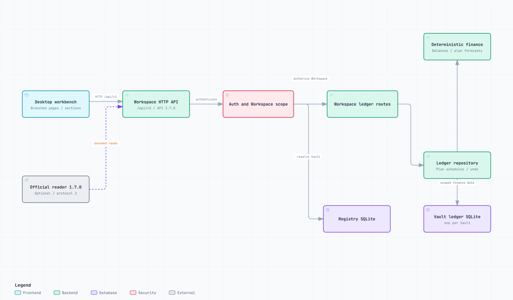

# Finance Core 3.7.1

Finance Core (FC) is a local-first finance domain and data service with a standalone desktop UI. FC owns financial rules, exact calculations, application operations, authentication and each Vault's SQLite. It runs independently of FRAG, model providers, banks, brokers and live market services.

**3.7.1 is a fix release.** [Workbench fixes](docs/md/09-workbench-fixes.md) improve space usage, typography, stable page transitions, branched navigation, account readouts, English controls and cash-flow plan scheduling. API **3.7.0**, ledger schema **3**, registry schema **1** and optional reader **1.7.0 / protocol 2** retain their versions. No dependency, production migration, installation or public release is included.

## Architecture



This is the only README architecture preview: **Light / 2048px**. [Editable Archify JSON](docs/architecture/finance-core-overview/finance-core-overview.archify.json) and the [checked standalone viewer](docs/architecture/finance-core-overview/finance-core-overview.html) are available for local inspection. The main in-process connections denote route-to-repository and repository-to-domain calls; HTTP, authentication, Workspace resolution and persistence boundaries are labeled explicitly.

- React pages use the Workspace-scoped HTTP client; they never open SQLite or calculate financial amounts.
- Domain rules do not import FastAPI, SQLite, React, FRAG, SFOS or LLM services.
- A User, Workspace/Vault and finance Account are distinct. Every finance request names a Workspace; a Vault owns one complete ledger database.
- Workspace reads, writes and lifecycle changes share a per-Vault lock. Run one FC writer process for a configured data root.
- The optional FC-owned reader accesses only selected released HTTP records. It is not another financial writer or dashboard runtime.

## Desktop workbench

The centered FINCR identity and sticky global navigation lead to independent Overview, Investment, Living, Master data and Settings views. A fluid desktop shell replaces the 1480px width cap. Shared main-column geometry, stable scrollbar gutters and natural page height avoid width and measured-height jumps. System fonts remain; labels are readable rather than compressed into 12–13px controls.

**BranchedMenu renders both navigation levels; LineSidebar is retired.** The supplied component's vertical trunk, parent headings, inset curved branches, vertical active marker and selected path are retained. Groups can stay independently open. Visiting a page discovers its actual Panel titles; retained branches can return to that page and exact heading. Selection targets the reading area near 25% of the viewport, subject to document bounds, without smooth-scroll inertia or a scroll-spy changing the selected branch. Master data and Settings use one-level entries from the same component.

Investment and Living retain distinct muted surfaces. White data cards, cool table headers, neutral alternating rows and visible borders provide contrast on Living pages. Status colors remain semantic. Monthly review and other multi-account readouts use T-account-style cards, with filters, exact server amounts, separate currencies and explicit Unknown states. T-account details remain read-only, paged Posting date / Debit / Credit records.

Overview adds a labeled SVG donut and horizontal bars for displayed record items and states. These counts include Unknown readouts where present; they are not combined money, income, returns or evidence of source completeness. Empty views do not invent sample financial data.

Application-owned date/month calendars, ISO date/datetime fields and file-selection labels use English. The external OS file dialog follows the user's system language; FC does not alter OS or browser language settings. Hover/focus help explains ordinary definitions; irreversible actions, errors, read-only states and unknown values stay visible. Desktop is the acceptance target; mobile/device acceptance is not claimed.

## Install and run

Requirements: Node.js, npm, Python 3.12 and `uv`. From the repository root:

```powershell
npm.cmd install --offline
uv sync --project backend --cache-dir .tmp/uv-cache
```

Existing pinned dependencies and notices remain subject to their reviewed licenses. No new package is required for 3.7.1.

Set a long random `FINANCE_CORE_ADMIN_TOKEN` before starting. `.env.example` documents supported variables; real values stay outside Git. `FINANCE_CORE_DATA_ROOT` optionally selects a local data root.

```powershell
$env:FINANCE_CORE_ADMIN_TOKEN = "<long-random-local-secret>"
npm.cmd run dev
```

- Standalone UI: `http://127.0.0.1:5174`
- API: `http://127.0.0.1:8788`
- OpenAPI: `http://127.0.0.1:8788/docs`

`npm.cmd run dev:api` starts only the backend. Synthetic sample loading requires an empty sandbox Vault. Authentication uses an owner session cookie; access tokens belong on authorized backend clients, not browser storage or source code.

## Accounting and review

Investment follows Journal → T-accounts → Securities & positions → Cash flow → Statements → Monthly review. Forms own their inputs; the shell coordinates routes, session and Workspace selection. Obsolete reads are cancelled and duplicate writes are blocked. A page and its scoped data change together after successful reads; failed navigation preserves existing input and unsaved-change protection.

Journal drafts require backend validation and separate human posting confirmation. Amounts, quantities, costs, prices and rates remain canonical Decimal strings. Cross-commodity postings require explicit valuation. Lot disposal requires explicit allocations; FC does not choose a cost-flow or tax policy. Posted entries are immutable; corrections use linked reversals. The existing [opening workflows](docs/md/06-opening-balances-and-notes.md) remain distinct from period income and spending.

Living uses actual-date balance observations, manual asset valuations and general beneficiary agreements. Missing months are unknown, not zero or interpolated values. Balance change is not income or spending. Investment pool assets are not automatically personal wealth. Formal month-end reports and confirmed closes retain their original basis and exact input revisions. Corrections preserve earlier observations and closes. See [unified accounting](docs/md/05-unified-personal-accounting.md).

### Cash-flow plans

Living **Cash-flow plans** supports Monthly, Quarterly, Semi-annual, Annual and One time. **Repeat interval** describes one occurrence per cycle; **Due day (1–31)** chooses a calendar day, not an occurrence count. Both have explanatory help. One-time plans use only their start date and hide Due day.

The optional `repeatEveryMonths` field accepts `1`, `3`, `6` or `12`, default `1`. Existing `/monthly-plans` routes and `recurringMonthly` requests retain their original monthly/one-time behavior when no extension is selected. The start month anchors repeating cycles. Due dates before the start date are excluded; shorter months use their last valid day without shifting later cycles. A February/day-31 quarterly plan is due February 28/29, May 31, August 31 and November 30.

Forecast amounts and category/currency totals are calculated by the backend, not React. They are never prorated into actual spending and never create transactions, payments or Journal entries. Schedule metadata stays in the existing Vault key/value store and participates in the same writer transaction and undo. No DDL migration or repurposed Note field is required. Full format-3 backups retain schedules; legacy format-2 backup refuses extended schedules rather than silently losing them.

### Monthly evidence report

`GET /api/v3/workspaces/{workspaceId}/reports/monthly-review?month=YYYY-MM` returns the completed anchor and prior two Asia/Shanghai calendar months. Cash movements and recognized income/expenses are separate backend calculations. Loans, principal investment, debt repayment and internal transfers are not income/expenses merely because cash moved. Signed reversal adjustments retain their own month; currencies remain separate.

Drafts are excluded, current account roles are stated, invalid posted dates block totals and real-world completeness remains unknown. A concrete `monthly-review:YYYY-MM` whitelist authorizes only that summary, not details, later months or an entire Vault. The optional reader retains whole required evidence or rejects an insufficient budget. This is on-demand evidence, not scheduled advice or trading.

### Import, export and undo

CSV/JSON import creates unposted drafts, never automatic postings. Balanced-row preview groups consecutive rows only when exact debit/credit totals balance, including one-to-many postings. Parent/reference captions do not silently determine grouping; rates are never inferred. Cross-date groups reject by default. An explicitly selected first-row policy preserves every source date and memo without editing the original file. Import and posting require separate confirmations.

Use full format-3 Vault backups for complete recovery. Restore validates format, schema, hash, schedules, financial history and foreign keys inside an empty target Vault. Ordinary reversible operations expose a single-use undo token, expire after ten minutes and are invalidated by later writes. Immutable observations and closes use explicit corrections, not ordinary undo. Exports and backups are private files; keep them outside Git.

## API and optional reader compatibility

The public API remains rooted at `/api/v3`. The [product 3.7.1 OpenAPI artifact](docs/release/finance-core-v3.7.1-openapi.json) and [release manifest](docs/release/finance-core-v3.7.1-release.json) record the compatible API 3.7.0 contract, including optional plan schedule metadata. There is no endpoint removal, required-field change or change to existing Journal calculations. Product, API, schema and plugin versions are independent.

Reader **1.7.0** still pins **API 3.7.0**, requires FRAG protocol **2** and host **1.12.1 or later**, and has unchanged selected-record permissions. Its existing archive contains exactly `manifest.json`, `adapter.py` and `ui.js`. A synthetic integration test reads the current API with a scoped read-only token. Neither reader source/archive nor FRAG's installed pins are changed by this fix. See [plugin contract and verification](docs/md/02-frag-finance-core-plugin.md).

```text
Cross-repo impact: NONE
Contract change: ADDITIVE
Other repo status: NOT_TOUCHED
Required compatible version: FC product 3.7.1 / API 3.7.0 / reader 1.7.0 / protocol 2
Reason: Optional plan schedule support and standalone UI fixes preserve existing reader routes and exact API pin.
```

## Verification and build output

```powershell
npm.cmd run test:ui
npm.cmd test -- --basetemp .tmp/<owned-synthetic-run>/pytest
npm.cmd run build
npm.cmd run check:versions
npm.cmd run check:release
python tools/build_frag_plugin.py --check
```

Use a fresh repository-local pytest base directory for each run. `tools/browser_layout_plans.mjs` verifies the real UI at 1440×900, 1600×1000, 1920×1080 and 2560×1440 against an explicitly isolated synthetic server and an owned named browser session. Configure `FC_UI_API_TARGET` for that server. Never point browser tests at a personal Vault or attach to the user's browser session. Unit tests, browser measurements, image-based visual review, human acceptance and production behavior are separate claims.

Production build output is **`dist/v3.7.1/`**. It contains `THIRD-PARTY-NOTICES.txt` and `REACT-BITS-LICENSE.txt`, linked from the footer. The user explicitly approved **React Bits BranchedMenu**, revision `d9085a5d6cb62a1c7512d8fa05a4f966736b575c`, under [MIT + Commons Clause](https://github.com/DavidHDev/react-bits/blob/d9085a5d6cb62a1c7512d8fa05a4f966736b575c/LICENSE.md). Copyright and permission text are retained; the components themselves must not be sold, sublicensed or redistributed separately. FC source disclosure is not required. This approval is scoped to the named component/use, not future dependencies. Hugeicons is not installed or bundled.

React 19.3.0, React DOM 19.3.0 and scheduler 0.28.0 remain pinned. Build checks verify notices and reject legacy API routes, browser storage, bundled fonts, private data and rule assets. Stable output filenames are overwritten without recursively clearing directories. FINCR logo/favicon SVGs remain original local identity assets. The approved Archify 2.17 documentation workflow retains its [MIT notice](docs/architecture/finance-core-overview/LICENSE-Archify.txt) and embedded JetBrains Mono OFL notice; documentation fonts are absent from the app bundle.

## Data safety and rollback

Do not commit personal finance data, databases/WAL/SHM files, credentials, original journals, private exports, screenshots or planning files. Default tests and browser evidence are synthetic. Real migration requires separate stopped-writer, backup and `REAL_DATA_MIGRATION_APPROVED` authorization. Vault deletion is recoverable quarantine of explicit files, not directory purge. Filesystem moves and SQLite are not crash-atomic; preserve backups and seek review after interruption.

Reverting 3.7.1 requires no schema migration. If extended forecasts exist, preserve a format-3 backup and explicitly review/convert or remove those plans in the current UI before running an older writer that cannot interpret their schedule metadata. The existing 3.0.0 Horizon PDF remains a candidate-direction baseline, not a promise of implemented functionality.

No commit, push, tag, production installation, real-data migration, banking/trading integration or public deployment is performed automatically.
