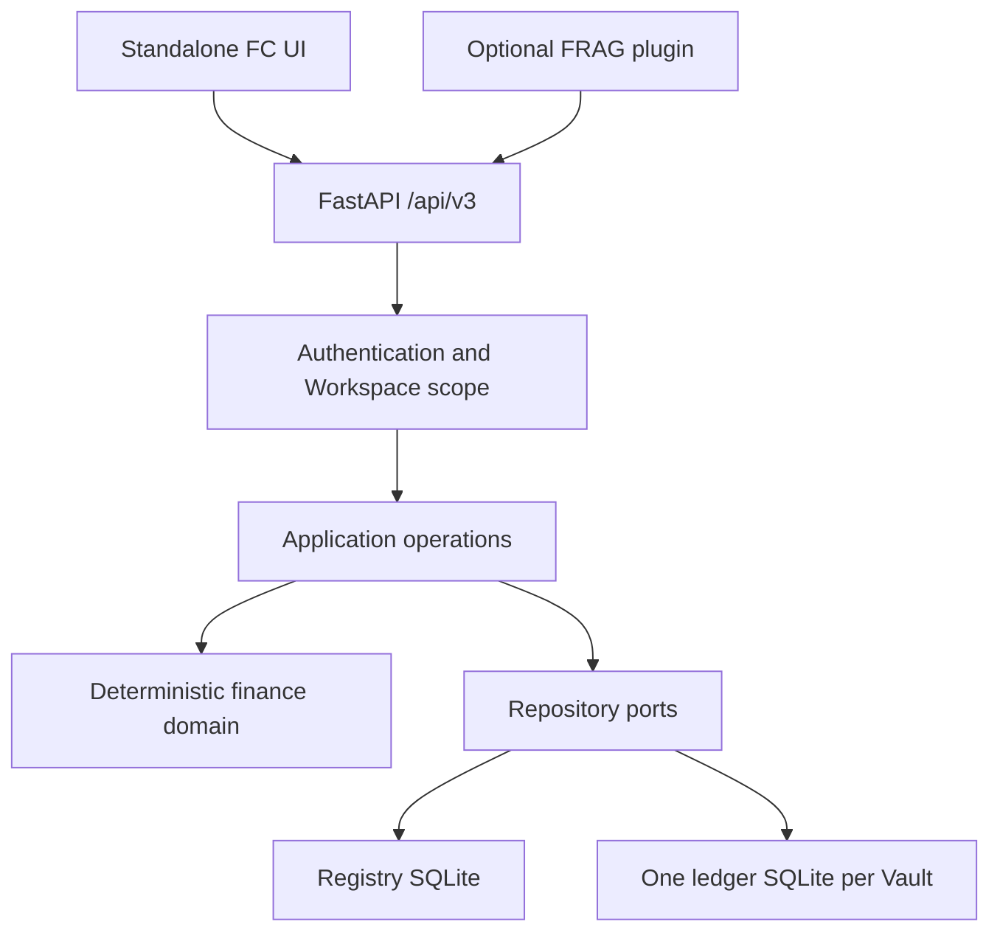
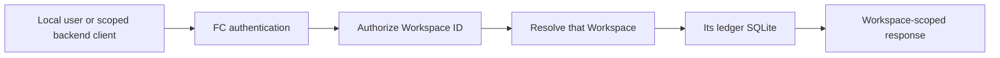
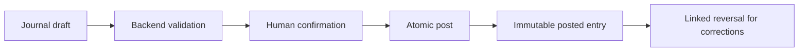
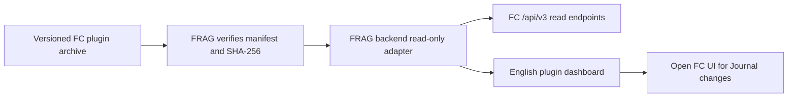

# Finance Core 3.1.1

Finance Core (FC) is a local-first finance domain and data service with its own standalone UI. An optional, separately released FRAG-harness plugin can read a small, selected set of FC records. FC remains independently runnable and is the only runtime that writes its finance SQLite files.

The standalone UI and the optional plugin use English. FC does not import FRAG, SFOS, LLM services, or private research files.

## Architecture



The UI and plugin use HTTP contracts. Domain rules do not depend on FastAPI, SQLite, the UI, or FRAG. A User, Workspace or Vault, and finance Account are distinct concepts. Every finance request names a Workspace.

FC provides Journal drafts and posting, commodities and typed accounts, explicit prices and FX valuation, lots and derived holdings, recurring draft generation, living accounts and monthly plans, reports and reconciliation, JSON and CSV import or export, backup, and operation-level undo. It does not provide trading, payments, bank or broker connections, live market data, model analysis, or investment advice.

## Install and run

Requirements: Node.js, npm, Python 3.12, and `uv`. Run these commands from the repository root:

```powershell
npm.cmd install --offline
uv sync --project backend --cache-dir .tmp/uv-cache
```

Set a long random `FINANCE_CORE_ADMIN_TOKEN` in your environment before starting FC. `.env.example` lists supported variables; keep real values out of Git. `FINANCE_CORE_DATA_ROOT` is optional.

```powershell
$env:FINANCE_CORE_ADMIN_TOKEN = "<long-random-local-secret>"
npm.cmd run dev
```

- Standalone UI: `http://127.0.0.1:5174`
- API: `http://127.0.0.1:8788`
- OpenAPI: `http://127.0.0.1:8788/docs`

To start only the API, run `npm.cmd run dev:api`. The standalone UI uses the published `/api/v3` HTTP API. It never reads SQLite or backend objects directly. Its light background and primary buttons use `#EFEEE7`; Public Sans is used for body text and controls, and Libre Bodoni for headings and display text. Fonts are bundled locally.

## Workspace and Journal flow



A Vault owns one complete finance SQLite. Requests cannot silently merge records across Vaults. Scoped access tokens belong on a backend, never in browser assets. Synthetic sample loading is available only for an empty sandbox Vault.



Amounts, quantities, costs, prices, and rates remain canonical Decimal strings in the public contract. Cross-commodity postings require an explicit valuation rate and rate type. Lot disposal requires explicit allocations; FC does not choose FIFO, LIFO, or a tax policy for the user. Posted entries cannot be edited or deleted.

## API and compatibility

The public API is rooted at `/api/v3`. `GET /api/v3/health` reports the API version and optional build or release commit metadata without paths or secrets. Version 3.1.1 corrects named OpenAPI response schemas for Journal and read models without changing runtime business semantics. `DraftValidationResponse` exposes `workspaceId`, `valid`, `issues`, and `preview`. Legacy `/api/v1` and `/api/v2` HTTP routes are no longer registered.

Control routes cover sessions, the current user, Workspaces, access tokens, and undo. Finance routes are scoped under `/api/v3/workspaces/{workspaceId}/...`. The [released OpenAPI artifact](docs/release/finance-core-v3.1.1-openapi.json) is the detailed endpoint and field contract.

Patch releases make compatible fixes. Minor releases may add endpoints or optional fields. Removing, renaming, changing requiredness, or changing semantics requires a new major version. FC 3.1.1's released OpenAPI artifact and manifest are in `docs/release/`.

Ordinary reversible create, update, delete, import, batch, balance-recording, and backup-restore operations return an operation ID, undo token, expiry, Workspace ID, and operation type. Undo is single-use, expires after ten minutes, and is invalidated by a later write. Posted facts use linked reversal instead of ordinary undo.

## Optional FRAG plugin



The plugin archive has exactly `manifest.json`, `adapter.py`, and `ui.js` at its root. It requires FRAG plugin protocol 1, FRAG host 1.0.0 or later, and FC API 3.1.1. The adapter exposes read-only dashboard and scope routes and reads at most ten explicitly selected Journal records from one authorized Workspace per request. FC credentials stay on the backend. All Journal mutations happen in FC's own UI after FC authentication.

See the [plugin archive contract and verification guide](docs/md/02-frag-finance-core-plugin.md). FRAG installation and release are separate repository tasks.

## Migration and data safety

Inspect a source database read-only, then use a dry run before any real migration:

```powershell
uv run --project backend python -m finance_core.maintenance inspect --source '<source-db>'
uv run --project backend python -m finance_core.maintenance migrate --source '<source-db>' --data-root '<new-data-root>' --display-name '<workspace-name>' --kind personal --dry-run
```

A real migration requires stopped writers, a backup, and separate `REAL_DATA_MIGRATION_APPROVED` authorization. The migration copies into a new Vault, validates SQLite integrity and foreign keys, and compares row counts and hashes. It does not overwrite or delete the source. Workspace deletion moves explicitly validated files into recoverable quarantine; permanent removal is a separate operation.

Do not commit real finance data, SQLite files, exports, backups, credentials, or personal planning files. Tests use synthetic fixtures and temporary or in-memory SQLite.

## Verify

```powershell
npm.cmd test
npm.cmd run build
npm.cmd run check:versions
npm.cmd run check:release
python tools/build_frag_plugin.py --check
```

The release check compares the generated OpenAPI schema and hash with the published 3.1.1 artifact. The plugin check verifies the archive contents and pinned hashes. Changes to FC and FRAG require separate review, commits, tags, and releases.
