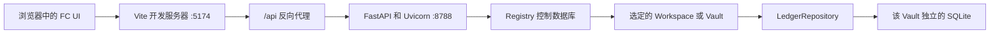

# Finance Core v3：API、环境变量与连接加载链路

本文用于复习 Finance Core（FC）3.0.0 的局部架构。它解释浏览器如何调用 API、PowerShell 环境变量如何进入后端进程，以及为什么一次错误的并发锁会让页面长期停留在“正在连接”。

本文只描述当前已经实现并验证的能力。Horizon 候选方向不属于本文的 capability。

## 1. 一张图理解 FC 的运行链路



关键边界：

- 浏览器只调用 HTTP API，不读取 SQLite。
- Vite 只负责前端开发服务器和 `/api` 代理，不执行财务规则。
- FastAPI 负责认证、Workspace scope、请求/响应合同和错误合同。
- Registry 保存 User、Workspace 元数据、session、access token 元数据和控制层 undo。
- 每个 Workspace/Vault 拥有一套完整且独立的财务 SQLite。
- `LedgerRepository` 负责持久化；确定性财务规则仍由 FC domain/application 代码控制。

## 2. User、Workspace/Vault 与 Account 不是同一概念

| 名称 | 含义 | 当前 FC 3.0.0 行为 |
| --- | --- | --- |
| User | 使用 FC 的身份 | 当前是一个本地 Owner User |
| Workspace / Vault | 一整个隔离的数据空间 | 一个 User 可以有多个 personal 或 sandbox Vault |
| Account | 财务会计账户 | 存在于某一个 Vault 内，例如现金、负债、收入账户 |

切换 Vault 不是切换某个财务 Account，而是切换整套 Commodity、Account、Draft、Journal、Lot、报表和计划数据库。

## 3. PowerShell 中 `$env:` 是什么

下面是 PowerShell，不是 Ruby：

```powershell
$env:FINANCE_CORE_ADMIN_TOKEN = "替换为你自己的长随机字符串"
```

逐段理解：

- `$` 表示 PowerShell 变量。
- `env:` 是 PowerShell 的环境变量驱动器。
- `FINANCE_CORE_ADMIN_TOKEN` 是变量名。
- `=` 把右侧字符串赋给环境变量。
- 代码块的语言标签应该写 `powershell`，写成 `ruby` 只会影响语法高亮。

`$env:` 中的冒号不能省略。下面的写法会让 PowerShell 把 `FINANCE_CORE_ADMIN_TOKEN` 解析成意外出现的语法标记，从而报告 `ParserError` 和 `UnexpectedToken`：

```powershell
$env FINANCE_CORE_ADMIN_TOKEN = "错误示例"
```

Windows 环境变量名称通常不区分大小写，但 Linux 环境变量区分大小写。为了与 FC 读取的名称完全一致并保持跨平台兼容，应始终使用全大写的 `FINANCE_CORE_ADMIN_TOKEN`，也不要把下划线改成连字符。

### 3.1 当前终端临时设置

该赋值默认只影响：

1. 当前 PowerShell 进程；
2. 从当前窗口启动的子进程，例如 `npm.cmd`、Uvicorn；
3. 不会自动进入已经在运行的另一个终端；
4. 关闭该 PowerShell 窗口后通常失效。

### 3.2 生成密码学安全的随机 token

下面的写法兼容 Windows PowerShell 5.1。它生成 48 个随机字节，再将其编码成约 64 个字符的 Base64 字符串：

```powershell
$secretBytes = New-Object byte[] 48
$randomGenerator = [System.Security.Cryptography.RandomNumberGenerator]::Create()
$randomGenerator.GetBytes($secretBytes)
$randomGenerator.Dispose()

$env:FINANCE_CORE_ADMIN_TOKEN = [Convert]::ToBase64String($secretBytes)
```

逐步理解：

1. `New-Object byte[] 48` 创建一个容纳 48 个字节的数组；
2. `RandomNumberGenerator::Create()` 创建适合密钥和 token 的密码学随机数生成器；
3. `.GetBytes(...)` 用随机数据填充数组；
4. `.Dispose()` 释放生成器占用的系统资源；
5. `ToBase64String(...)` 把不适合直接输入的原始字节编码为文本；
6. 最后一行只把结果放入当前 PowerShell 进程，不会自动写入 Git。

Base64 是编码而不是加密。token 的强度来自 48 个密码学安全的随机字节，而不是 Base64 本身。

不要为了检查是否成功而直接打印 token。可以只检查它是否存在以及字符长度：

```powershell
if ($env:FINANCE_CORE_ADMIN_TOKEN) {
    "FC Admin Token 已设置，长度为 $($env:FINANCE_CORE_ADMIN_TOKEN.Length)"
}
```

### 3.3 一次生成，保存为当前 Windows 用户环境变量

如果不想每次启动 FC 都重新输入生成代码，可以生成一次并保存到当前 Windows 用户的环境变量：

```powershell
$secretBytes = New-Object byte[] 48
$randomGenerator = [System.Security.Cryptography.RandomNumberGenerator]::Create()
$randomGenerator.GetBytes($secretBytes)
$randomGenerator.Dispose()

$token = [Convert]::ToBase64String($secretBytes)

[Environment]::SetEnvironmentVariable(
    "FINANCE_CORE_ADMIN_TOKEN",
    $token,
    "User"
)
```

这里的 `"User"` 表示保存到当前 Windows 用户环境，而不是整台电脑。设置完成后需要关闭并重新打开 PowerShell，新终端才能自动获得该环境变量。之后可以直接运行：

```powershell
npm.cmd run dev
```

这种方式保存的是同一个 token，并不是每次启动自动生成一个新 token。FC 后端会在启动时读取它；浏览器仍需用该 token 换取 HttpOnly 登录会话。浏览器 Cookie 有效时可以直接进入，Cookie 过期、退出登录或被清除后，需要再次输入原来的 token。

建议同时把 token 保存到密码管理器。Windows 用户级环境变量适合本地个人使用，但当前用户权限下运行的其他程序也可能读取它；正式部署时应改用操作系统密钥库或专用 secret manager。不要使用 `"Machine"`，也不要把真实 token 写入 `.env`、README、截图、聊天记录或 Git。

如需取消用户级永久配置：

```powershell
[Environment]::SetEnvironmentVariable(
    "FINANCE_CORE_ADMIN_TOKEN",
    $null,
    "User"
)
```

### 3.4 可选的数据根配置

```powershell
$env:FINANCE_CORE_DATA_ROOT = ".local-data/v3"
```

`.env.example` 只是变量名称模板，不包含真实 secret，也不代表 `npm.cmd run dev` 会自动加载它。当前推荐方式是在启动命令之前，于同一个 PowerShell 窗口设置环境变量。

## 4. `npm.cmd run dev` 实际启动了什么

`package.json` 使用 `concurrently` 启动两个子进程：

```text
npm.cmd run dev
├─ dev:api  -> Uvicorn / FastAPI，监听 127.0.0.1:8788
└─ dev:demo -> Vite，监听 127.0.0.1:5174
```

浏览器打开：

```text
http://127.0.0.1:5174
```

Vite 在开发环境把相对地址 `/api/...` 转发给：

```text
http://127.0.0.1:8788/api/...
```

因此“UI 页面能打开”只证明 Vite 曾经返回过 HTML/JavaScript，不一定证明 API 仍然运行。

## 5. 启动时的认证流程

### 5.1 本地管理会话

FC UI 的管理登录流程是：

```text
浏览器输入 admin token
-> POST /api/v3/session
-> 后端验证 FINANCE_CORE_ADMIN_TOKEN
-> 返回 HttpOnly session cookie
-> 后续浏览器请求自动携带 cookie
```

浏览器 JavaScript不能读取 HttpOnly cookie。这减少了页面脚本意外泄露 session secret 的风险。

### 5.2 Scoped access token

SFOS 或其他后端客户端使用 scoped Bearer token：

```http
Authorization: Bearer fcv3_...
```

token 可以限制：

- 允许访问哪些 `workspaceId`；
- `ledger:read`；
- `ledger:write`。

Bearer token 只应存在于调用方 backend，不得进入浏览器、日志、截图、导出或 Git。token 明文只在创建时返回一次；撤销 token 是最终操作，没有 undo。

## 6. API 路径与调用示例

### 6.1 无需认证的健康检查

```powershell
Invoke-RestMethod "http://127.0.0.1:8788/api/v3/health"
```

它用于确认：API 进程可连接、Registry 可执行查询，以及 service/API/schema 版本。

### 6.2 在 PowerShell 中建立本地管理会话

```powershell
$fcSession = New-Object Microsoft.PowerShell.Commands.WebRequestSession
$loginBody = @{ adminToken = $env:FINANCE_CORE_ADMIN_TOKEN } | ConvertTo-Json
Invoke-RestMethod `
  -Uri "http://127.0.0.1:8788/api/v3/session" `
  -Method Post `
  -ContentType "application/json" `
  -Headers @{ Origin = "http://127.0.0.1:5174" } `
  -Body $loginBody `
  -WebSession $fcSession
```

不要把 `$loginBody`、cookie 或真实 token 输出到日志。

### 6.3 查询当前 User 和 Workspace

```powershell
Invoke-RestMethod "http://127.0.0.1:8788/api/v3/me" -WebSession $fcSession
$workspaceResponse = Invoke-RestMethod "http://127.0.0.1:8788/api/v3/workspaces" -WebSession $fcSession
```

### 6.4 调用一个明确的 Vault

```powershell
$workspaceId = $workspaceResponse.data[0].id
Invoke-RestMethod "http://127.0.0.1:8788/api/v3/workspaces/$workspaceId/dashboard" -WebSession $fcSession
```

所有财务端点必须包含 `/workspaces/{workspaceId}`。一个请求只属于一个 Vault；FC 不会跨 Vault 自动合并余额、持仓或报表。

## 7. 本次 loading 卡死的真实原因

旧首屏行为包含两层问题。

### 7.1 前端一次读取过多

旧 UI 先依次等待：

1. `/api/v3/health`；
2. `/api/v3/me`；
3. `/api/v3/workspaces`。

选择 active Vault 后，又并发请求 18 个 scoped ledger endpoint。`Promise.all` 要求全部成功后才执行 `render()`；任何一个请求悬挂，页面都会一直显示“正在连接”。旧 `fetch()` 也没有超时。

### 7.2 `threading.RLock` 与 FastAPI 请求生命周期不匹配

旧 `workspace_context` 是同步 generator dependency：

```text
工作线程 A 获取 threading.RLock
-> endpoint 执行
-> FastAPI 可能在工作线程 B 清理 dependency
-> 工作线程 B 尝试释放 A 拥有的 RLock
-> RuntimeError: cannot release un-acquired lock
```

`threading.RLock` 具有线程所有权，必须由获取它的同一线程释放。真实并发复现会导致部分请求报错或持续等待。

### 7.3 Registry connection 也需要同步

修复 Vault 锁后，并发认证又暴露了第二个问题：多个工作线程同时使用同一个 Registry SQLite connection，会产生 `sqlite3.InterfaceError`。因此 Registry 的 session、token、Workspace 元数据和 audit 操作必须在各自同步函数内部使用 Registry 的 `RLock`。

## 8. 当前修复后的加载模型

Vault 使用 `asyncio.Lock`，由 async dependency 在同一个事件循环任务中获取和释放。等待同一 Vault 的其他请求不会占满 FastAPI 工作线程；实际 SQLite repository 操作仍保持单 Vault 串行。

UI 先完成控制层连接并显示页面框架，然后只读取当前页面需要的数据：

| 页面 | 首次进入时读取的主要数据 |
| --- | --- |
| 概览 | health、dashboard、reconciliation、latest undo |
| 交易 | commodities、accounts、drafts、entries、latest undo |
| 持仓与报表 | holdings、statements、cash flow、T-accounts |
| 生活与计划 | commodities、living accounts、snapshots、plans、world |
| 自动化与数据 | commodities、accounts、drafts、recurring rules、latest undo |
| 主数据 | commodities、accounts、price quotes、latest undo |
| 设置 | Workspace 和 access token 元数据 |

每个请求有 5 秒前端超时。切换页面或 Vault 时，旧请求会被取消；代次检查阻止旧 Vault 响应覆盖新 Vault 状态。切换 Vault 前还会清空页面缓存，避免短暂显示另一个 Vault 的数据。

## 9. loading 排障顺序

### 9.1 先检查 API，而不是反复刷新浏览器

```powershell
Invoke-RestMethod "http://127.0.0.1:8788/api/v3/health"
```

如果失败，查看运行 `npm.cmd run dev` 的 PowerShell 中 `[api]` 开头的输出。

### 9.2 查看两个端口

```powershell
Get-NetTCPConnection -State Listen -ErrorAction SilentlyContinue |
  Where-Object { $_.LocalPort -in 5174,8788 } |
  Select-Object LocalAddress,LocalPort,OwningProcess
```

- 只有 `5174`：前端在运行，后端没有运行。
- 只有 `8788`：API 在运行，Vite 没有运行。
- 两者都没有：启动窗口已关闭、进程启动失败或正在重启。

### 9.3 浏览器 Network 面板

重点查看：

- 哪个 `/api/v3` 请求处于 pending；
- HTTP 状态是否为 401、403、404、409、500 或 502；
- 请求路径是否包含正确的 `workspaceId`；
- 不要截图或复制 Authorization、cookie、request body。

### 9.4 常见状态含义

| 状态 | 常见含义 |
| --- | --- |
| 401 | 没有有效 session/token，或 token 已撤销/过期 |
| 403 | token scope 不足，或 session Origin 不可信 |
| 404 | Workspace 不存在、无权限或已隔离 |
| 409 | archived Vault 写入、undo 冲突或业务状态冲突 |
| 422 | 请求字段不符合 API contract |
| 500 | 后端缺陷；应查看终端 traceback，不应只延长 loading |
| 502 | Vite 能运行，但无法连接代理目标 API |

## 10. 源码局部解构索引

| 文件 | 当前责任 |
| --- | --- |
| `package.json` | 启动 API/UI、测试、build 和版本检查命令 |
| `vite.config.js` | 将浏览器 `/api` 请求代理到本地 API |
| `demo/src/app.js` | FC UI 状态、认证、按页请求、Vault 切换和交互 |
| `backend/finance_core/app_v3.py` | FastAPI app、lifespan、中间件和统一错误响应 |
| `backend/finance_core/api_v3.py` | v3 认证、Workspace scope、token scope 和 scoped router |
| `backend/finance_core/registry.py` | Registry SQLite、Vault handle、session/token、控制层 undo |
| `backend/finance_core/api_v2.py` | 被 v3 scoped router 复用的通用 ledger HTTP adapter 实现 |
| `backend/finance_core/ledger_repository.py` | 每个 Vault 内的 ledger persistence 和 operation undo |
| `backend/finance_core/database.py` | SQLite connection、schema 初始化和基础 repository |

`api_v2.py` 的文件名是历史实现名称；FC 3.0.0 运行时只注册 `/api/v3`，不会公开 `/api/v2`。

## 11. 复习问题

1. 为什么设置 `$env:FINANCE_CORE_ADMIN_TOKEN` 后必须从同一个 PowerShell 启动 FC？
2. 为什么 UI 可以打开但 API 仍可能没有运行？
3. 为什么所有财务 API 都必须包含 `workspaceId`？
4. admin session 和 scoped Bearer token 分别适合什么调用方？
5. 为什么 `threading.RLock` 不能跨 FastAPI 工作线程获取和释放？
6. 为什么 `Promise.all` 中一个 pending request 会阻止整个首屏 render？
7. 为什么切换 Vault 时要先清空旧页面数据并取消旧请求？
8. 遇到持续 loading 时，为什么应先检查 `/api/v3/health` 和后端 traceback？
